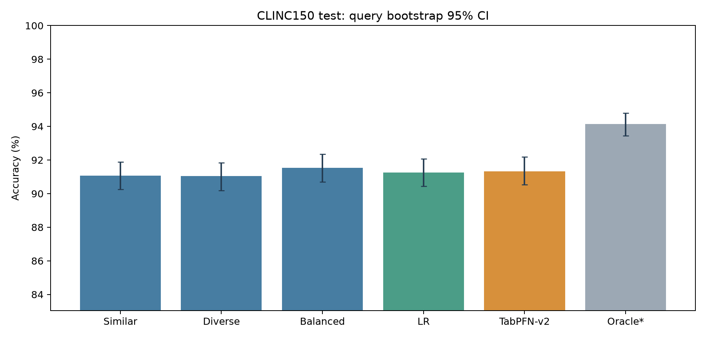
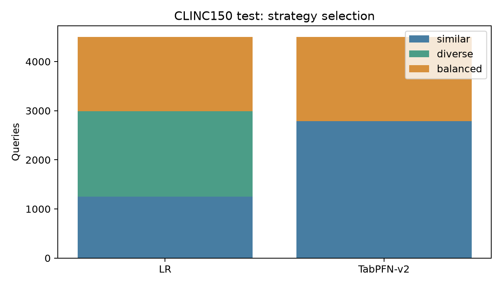
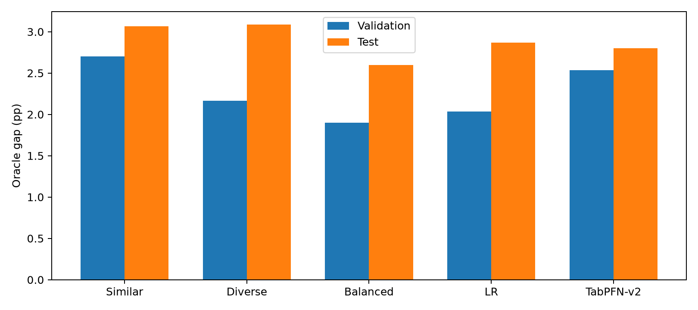

# CLINC150 查询自适应示例选择实验报告

CLINC150 全量实验已完成。TabPFN-v2 在 Test 上为 **91.333%（4110/4500）**，相对 Similar 净增12条、+0.267个百分点；双侧精确 McNemar p=0.08069，Holm p=0.72621，未达到统计显著。Validation 预先选定的固定 Balanced 为 **91.533%（4119/4500）**，比 TabPFN 多对9条。因此，本轮观察到策略切换与小幅数值收益，但没有确认自适应选择优于固定策略的可靠优势。

## 实验方法

官方 clinc/oos-eval/data/data_full.json，commit 828f8093932c8fe6ca7936c3d2e52903b1c523de；仅取 train/val/test 中150个 in-scope 标签，OOS单独分组全部排除。官方训练15000条，经seed42分层划分为10000 Demo与5000 Meta；官方Validation 3000、Test 4500保持原顺序与内容。标签文本原样保留；原文件没有整数类ID，按官方Train首次出现顺序保存可逆映射。

冻结 Qwen2.5-1.5B-Instruct（989aa7980e4cf806f80c7fef2b1adb7bc71aa306），原生MPS FP16、greedy、max_new_tokens32；嵌入冻结all-MiniLM-L6-v2（1110a243fdf4706b3f48f1d95db1a4f5529b4d41），CPU、256 token编码上限，与原Banking77编码约定一致。推理提示上限4096，预检全量提示，无截断。

仅Demo可作为检索候选。归一化cosine Top32，排除自身ID和规范化完全相同文本；Similar取最相关8条，Diverse从最相关候选开始greedy MaxMin，Balanced用MMR λ=.5；所有提示按query相似度降序、ID打破平局统一排列。提示结构沿用Banking77，仅将银行领域文字适配为150 intents的通用任务。

四维特征为max_similarity、mean_similarity、entropy_bits、top_label_vote。元标签在5000 Meta查询上，比较三种提示下gold intent continuation的平均token log-likelihood，不含prompt、padding、EOS；容差1e-6，优先Similar→Balanced→Diverse。LR原StandardScaler与嵌套分层CV；TabPFN官方v2、4 estimators、seed42，复用固定checkpoint但重新训练CLINC上下文，不加载Banking77已训练选择器。

先完成元评分、选择器训练、无gold的Validation/Test路由和Validation评估，随后封存模型/配置/路由/Validation最佳固定策略，最后运行Test预测并在预测封存后连接Test gold。跨split重复审计使用文本，不参与调参或预测。

## 数据完整性与元标签

规范化跨分区完全重复对数=52；char_wb 3–5 gram TF-IDF cosine≥.90近重复对数=4061。完整配对见duplicate_audit.json。这些是潜在重叠风险，不等于全部是泄漏；保留官方分区、不删除测试样本。候选排除规范化完全相同文本，近重复保留并披露。

元标签分布为 Similar 1950条（39.00%）、Diverse 1246条（24.92%）、Balanced 1804条（36.08%）。top-two 似然差均值为0.036386，中位数仅0.00009535；3844/5000条（76.88%）margin≤0.001，134条在1e-6容差内并列。均值不能代表大多数查询的标签分离程度。

| 训练诊断 | LR | TabPFN-v2 |
|---|---:|---:|
| 同一1000条内部holdout元标签准确率 | 34.90% | 39.20% |
| 内部holdout元标签Macro-F1 | 0.34253 | 0.29166 |
| 嵌套OOF元标签准确率 | 37.48% | 未运行 |
| 嵌套OOF元标签Macro-F1 | 0.36803 | 未运行 |

内部holdout多数元标签基线为39.00%，TabPFN的39.20%仅高0.20个百分点；这提示似然argmax标签的可预测信号有限。这里不能断言模型完全没有学到信息，也不能把内部元标签准确率当作下游意图准确率。LR的最优参数是C=10、class_weight=balanced，全部由Meta-training内部CV选择。两模型均重新在完整5000条Meta上拟合；没有使用Validation或Test调参。

### 分区规模与跨分区重叠

| 分区 | 样本数 | 意图数 | 每个意图的样本数 |
|---|---:|---:|---|
| demonstration_pool | 10000 | 150 | 66 至 67 |
| meta_training | 5000 | 150 | 33 至 34 |
| validation | 3000 | 150 | 20 至 20 |
| test | 4500 | 150 | 30 至 30 |

| 记录对所属分区 | 规范化完全重复对数 | 词面近重复对数 |
|---|---:|---:|
| test / train | 20 | 1345 |
| test / validation | 5 | 255 |
| train / train | 11 | 1552 |
| train / validation | 16 | 909 |

表中train / train指Demo与Meta之间，不含单个分区内的重复。计数单位是记录对，不是唯一查询数。Train与Test之间有20对规范化完全重复，Train与Validation有16对，Validation与Test有5对；这些官方分区重叠会限制评估独立性。检索候选的完全匹配排除降低了直接复用同文本Demo的风险，但不能消除元训练重叠、近重复或预训练数据的影响。本轮按任务保留官方数据，不以审计结果重新筛选Test。

## 官方 Validation 结果

| 方法 | Accuracy | Macro-F1 | 正确数 | Invalid | S / D / B |
|---|---:|---:|---:|---:|---|
| always_similar | 91.667% | 0.91655 | 2750/3000 | 0.600% | 3000/0/0 |
| always_diverse | 92.200% | 0.92167 | 2766/3000 | 0.333% | 0/3000/0 |
| always_balanced | 92.467% | 0.92515 | 2774/3000 | 0.400% | 0/0/3000 |
| logistic_regression | 92.333% | 0.92351 | 2770/3000 | 0.433% | 815/1235/950 |
| tabpfn_v2 | 91.833% | 0.91886 | 2755/3000 | 0.667% | 1815/0/1185 |
| oracle_retrospective | 94.367% | 0.94410 | 2831/3000 | 0.300% | 2919/15/66 |

## 官方 Test 结果

| 方法 | Accuracy | Macro-F1 | 正确数 | Invalid | S / D / B |
|---|---:|---:|---:|---:|---|
| always_similar | 91.067% | 0.90995 | 4098/4500 | 0.444% | 4500/0/0 |
| always_diverse | 91.044% | 0.91061 | 4097/4500 | 0.467% | 0/4500/0 |
| always_balanced | 91.533% | 0.91572 | 4119/4500 | 0.400% | 0/0/4500 |
| logistic_regression | 91.267% | 0.91222 | 4107/4500 | 0.444% | 1248/1744/1508 |
| tabpfn_v2 | 91.333% | 0.91279 | 4110/4500 | 0.444% | 2789/0/1711 |
| oracle_retrospective | 94.133% | 0.94176 | 4236/4500 | 0.267% | 4362/35/103 |

Oracle行是gold-assisted事后上界，不可部署。为完整计算其F1/invalid，见证规则为正确Similar优先，其次Balanced、Diverse，全部失败则Similar；这些附属指标属于该见证，不是Oracle上界的固有属性。Macro-F1固定150类，invalid记错误及对应gold类FN；不修复或模糊匹配模型输出。

## 策略切换与互补空间

Test Similar错误=402；可由D/B挽救=138；Oracle余量=3.067pp；三策略全部错误=264。

logistic_regression：有益=78、有害=69、中性切换=3105；切换率=72.267%；挽救率=56.522%；净兑现Oracle余量=6.522%。Accuracy gain=(有益−有害)/N；中性包括同对或同错，切换率本身不代表收益。

tabpfn_v2：有益=26、有害=14、中性切换=1671；切换率=38.022%；挽救率=18.841%；净兑现Oracle余量=8.696%。Accuracy gain=(有益−有害)/N；中性包括同对或同错，切换率本身不代表收益。

## 配对统计

tabpfn_v2 − always_similar：Δ=+0.267pp，配对95% CI=[0.000, +0.556]pp，双侧精确 McNemar p=0.0806905，Holm p=0.726214。

logistic_regression − always_similar：Δ=+0.200pp，配对95% CI=[-0.333, +0.733]pp，双侧精确 McNemar p=0.509502，Holm p=1。

tabpfn_v2 − always_balanced：Δ=-0.200pp，配对95% CI=[-0.711, +0.311]pp，双侧精确 McNemar p=0.506596，Holm p=1。

每个split用5000次seed42查询级配对bootstrap，所有方法共享重抽样索引；同时输出Accuracy和Macro-F1的单方法区间与配对差区间。双侧精确McNemar基于逐题对错不一致对。Holm比较家族事先固定为5个可部署方法之间10个无序比较；Oracle比较单列，仅解释上界。Test不能重新选择最佳固定策略；若Validation最优与Test最优不同，仍按封存的Validation选择作主要对照。查询bootstrap不覆盖训练划分随机性。

数值提升与显著提升分别判断：净正确数可为正，但应同时检查配对CI是否跨0、主要检验p及预声明Holm结果。Validation已经用于固定基线选择，其探索性结果不当作独立确认；Test结果不用于修改模型。

本轮 Accuracy 增益的bootstrap区间下端恰为0，属于离散小样本事件下的边界结果，不能按舍入后的正值解释为显著。Accuracy 的精确 McNemar p=0.08069，没有拒绝零假设。TabPFN−Similar 的 Macro-F1 差为+0.00284，未校正bootstrap 95%区间约为[+0.00019,+0.00580]；这是次要指标的探索性结果，不能替代主要Accuracy检验，也没有进行Macro-F1家族校正。所有可部署方法两两比较的Test Holm p均大于0.05。

Balanced−Similar 的Test差为+0.467pp、精确p=0.14124；Balanced是本轮合理的部署候选和预选基线，但不能把其数值最高写成已证实统计优胜。

## 与 Banking77 原始 8-shot 的描述性对照

| 方法 | Banking77 Test | CLINC150 Test |
|---|---:|---:|
| always_similar | 88.831% | 91.067% |
| always_diverse | 87.922% | 91.044% |
| always_balanced | 88.961% | 91.533% |
| logistic_regression | 88.734% | 91.267% |
| tabpfn_v2 | 88.831% | 91.333% |
| oracle_retrospective | 91.753% | 94.133% |

CLINC150 Test数值最佳固定策略为 always_balanced（91.533%）；Similar为91.067%。这个Test排名仅事后描述，实际对照仍由Validation冻结。TabPFN选择S/D/B=[2789, 0, 1711]，使用2种策略；需要将集中偏好、切换行为和有益净收益分别评价，不能仅由选择分布证明有效自适应。

Banking77原始TabPFN所有3080条均选Similar，增益0；Oracle余量2.922pp。CLINC150的对应余量为3.067pp，净兑现为8.696%。余量反映三种既定上下文的互补潜力，是否可预测取决于路由是否命中有益查询。

CLINC150 的 TabPFN 已摆脱原始 Banking77 的全Similar输出，但其Test收益只占可挽救错误余量的8.70%，且低于固定Balanced。这支持“数据集改变会影响选择器行为”的描述性结论，尚不支持“互补性已被更可靠地预测”或“TFM优于固定ICL”。

两个数据集的样本量、标签数、领域、Demo/Meta分配均不同，本比较是描述性的。不能据此认定CLINC150更难、某种语义结构导致收益，或TFM必然优于固定ICL。

## 逐类表现与误差模式

always_similar主要混淆：

- todo_list → todo_list_update：26条。

- shopping_list → shopping_list_update：21条。

- change_ai_name → change_user_name：21条。

- oil_change_when → oil_change_how：16条。

- insurance → insurance_change：13条。

- damaged_card → report_lost_card：11条。

- calendar → calendar_update：8条。

- change_accent → change_language：7条。

- ingredients_list → recipe：6条。

- what_is_your_name → user_name：6条。

always_similar准确率最低的10类（每类30条，小样本波动需谨慎）：

- todo_list：4/30，13.3%。

- change_ai_name：8/30，26.7%。

- shopping_list：8/30，26.7%。

- oil_change_when：13/30，43.3%。

- damaged_card：16/30，53.3%。

- insurance：17/30，56.7%。

- change_user_name：18/30，60.0%。

- calendar：20/30，66.7%。

- distance：20/30，66.7%。

- what_is_your_name：21/30，70.0%。

tabpfn_v2主要混淆：

- todo_list → todo_list_update：26条。

- change_ai_name → change_user_name：21条。

- shopping_list → shopping_list_update：19条。

- insurance → insurance_change：14条。

- oil_change_when → oil_change_how：11条。

- damaged_card → report_lost_card：11条。

- calendar → calendar_update：9条。

- reminder_update → reminder：6条。

- change_accent → change_language：6条。

- ingredients_list → recipe：6条。

tabpfn_v2准确率最低的10类（每类30条，小样本波动需谨慎）：

- todo_list：4/30，13.3%。

- change_ai_name：8/30，26.7%。

- shopping_list：10/30，33.3%。

- damaged_card：15/30，50.0%。

- insurance：16/30，53.3%。

- change_user_name：18/30，60.0%。

- oil_change_when：18/30，60.0%。

- calendar：19/30，63.3%。

- distance：20/30，66.7%。

- what_is_your_name：21/30，70.0%。

完整150类表、无效输出、150×151混淆矩阵、全部逐题预测及15组方法对的预测/正确性分歧已保存。不同无效raw输出在预测分歧统计中保持不同类别；在Accuracy中一律错误。

## 对研究问题的直接回答

1. **Similar是否仍然强。** 是，Test达到91.067%；Diverse为91.044%，几乎持平。增加意图类别数并未使Similar基线失效。
2. **哪种固定策略最好。** Balanced在Validation和Test均数值最高，分别为92.467%和91.533%；本轮在Test之前已根据Validation冻结了Balanced，未用Test挑选基线。
3. **TabPFN是否自适应。** 它在Test上选择2789次Similar（61.98%）和1711次Balanced（38.02%），未选择Diverse。行为上存在逐查询切换；准确率上未证实优于固定Balanced。
4. **Oracle空间是否变大。** CLINC150的Oracle−Similar为3.067pp，Banking77原始Test为2.922pp，只大约0.145pp，不能称为互补空间大幅扩张。CLINC150仍有264条三策略全错，单纯路由无法挽救。
5. **策略互补是否更可预测。** TabPFN取得26次有益与14次有害切换，说明存在正向数值信号；但主要检验不显著，内部元标签准确率仅接近多数类基线，相对Balanced又少对9条。证据不足以认定可预测性有可靠提升。
6. **何时使用固定或自适应策略。** 在本轮设置下，应优先采用Validation选定的固定Balanced作为后续验证/部署候选。要主张自适应值得增加复杂度，仍需在新数据或多seed独立协议中确认它超过预选固定策略，并持续满足有益切换大于有害切换；本轮不据Test继续调参。

## 为什么切换增加了 收益却仍然有限

**大多数样本对策略变化不敏感。** Test中3964条三策略全对，264条三策略全错，两者合计4228/4500（93.96%）；只有272条（6.04%）的对错状态会随策略变化。TabPFN虽然切换了1711条，却仅改变48条的完整预测类别、40条的对错状态；1671次切换为中性，占切换的97.66%。这解释了38.02%的策略切换率为何只转化为0.267pp的净收益。

**似然监督与greedy准确率没有完全对齐。** 76.88%的训练查询三策略top-two似然差≤0.001；即使三者都给出正确标签，似然微差仍会产生某个唯一meta-label。训练目标会为这些对准确率没有贡献的变化分配监督，而真正决定净收益的是稀少的错转对与对转错事件。这是与观测相容的机制解释，不是对噪声来源的因果证明。

**四个特征遗漏了具体意图边界。** 它们只概括邻域相关性与标签分布，没有直接保留“查看还是更新列表”“AI名字还是用户名字”“何时换油还是如何换油”等语义差别。本轮错误集中在这些细粒度边界：TabPFN仍有26条todo_list→todo_list_update、21条change_ai_name→change_user_name；oil_change_when正确数由Similar的13/30提高到18/30，但insurance由17/30降到16/30，damaged_card由16/30降到15/30。类别变化仅为每类30条的描述性分析，不作逐类显著性宣称。

**Baseline的选择会改变结论。** 相对Similar，TabPFN净增12条；相对预选Balanced，则有68条独有正确、77条独有错误，净少9条。固定Balanced相对Similar本身已净增21条。不能只以Similar为对照，就把模型学到的策略偏好解释为额外的自适应价值。

## 相同策略比例的事后描述性诊断

下表假设把现有S/D/B选择次数保持不变，再将策略独立随机分配给查询。其期望准确率可直接由“各策略选择占比×对应固定策略准确率”的总和计算。这里没有重新训练、调用LLM或按Test选择配置；这是事后描述性诊断，不属于预声明主要检验，也不是显著性证明。

| Split | 选择器 | 实际Accuracy | 同比例随机分配的期望Accuracy | 实际高于期望的差值 |
|---|---|---:|---:|---:|
| validation | logistic_regression | 92.333% | 92.140% | +0.194pp |
| validation | tabpfn_v2 | 91.833% | 91.983% | -0.149pp |
| test | logistic_regression | 91.267% | 91.214% | +0.052pp |
| test | tabpfn_v2 | 91.333% | 91.244% | +0.089pp |

TabPFN在Validation低于同策略比例随机分配的期望，在Test仅略高于该期望。这进一步限制了“查询特征已经提供稳定路由优势”的解释；仅凭策略占比与正净收益，无法确认匹配query本身的独立贡献。

## 图表与可追溯产物

所有要求的CSV、配置、Oracle分析、验证文件均在本目录。`independent_metric_checks.csv`用sklearn独立重算两split全部六方法的Accuracy/Macro-F1，逐项与保存指标一致；`execution_environment.json`记录依赖版本、模型权重blob校验及全部37500条逻辑记录的缓存核验。`tabpfn_switch_examples.csv`保存按query_id排序的前5个有益和前5个有害切换案例，避免只挑成功案例。

本次运行经历两次用户要求的暂停，均在校验断点后恢复；完整推理缓存与模型没有丢失。Qwen和MiniLM权重SHA256与固定Hub blob一致；原项目682个受保护文件未变。原项目162项测试及CLINC150新增6项测试通过，两模型的保存/重载预测核验通过。TabPFN包版本为9.2.0。本轮仅完成当前冻结配置，不将负结果隐去，也不把Test数值差异当成后续调参依据。

## 复现与限制

运行入口为 ../run_experiment.sh；原始配置见experiment_config.json；阶段日志位于../logs；输入/嵌入位于../data；共享提示缓存位于../cache；CLINC新训练上下文与模型位于../models。results/verification.json核验原Banking77及共享源代码未改、全量计数、冻结协议和来源hash。

三策略如果生成完全相同的完整提示，复用同一冻结模型输出；不同提示仍分别真实推理。自适应答案逐ID查表复用固定预测，不重复调用Qwen。所有成功操作原子缓存并fsync保存日志；中断后同命令恢复。

本轮只有seed42与一个LLM，结论不涵盖跨seed或跨模型稳定性；似然元标签可能与greedy正确性不一致；近重复可能使评估偏乐观；多数中性样本会掩盖稀少正负切换。后续应在新的独立协议下研究，不使用本Test反复调参。

数据来源：[CLINC150官方仓库](https://github.com/clinc/oos-eval/tree/828f8093932c8fe6ca7936c3d2e52903b1c523de)。Banking77对照来源：项目experiments/banking77_8shot_final_test/results/test_metrics.csv与summary.md。

报告排版及独立核验复现：完成原入口脚本后，运行 `.venv/bin/python experiments/clinc150_8shot/results/finish_report.py`。该脚本只核验已有产物并整理报告，不改变冻结的模型或统计方案。

## 仓库发布说明

本目录是已完成实验的结果快照。报告图像路径已改为仓库相对路径，数值结果未改。运行时的verification.json及frozen_protocol.json保留原始审计记录，其中机器路径和历史文件hash属于原运行环境，不表示克隆仓库后已有全部推理缓存。发布文件的hash与原件对照见../PACKAGING_MANIFEST.json；无需模型即可运行 `python CLINC150_8shot/verify_results.py` 核验已发布结果。全量复现请按../README.md，在reproduction目录运行，输出写入独立实验目录，不会覆盖本结果快照。
